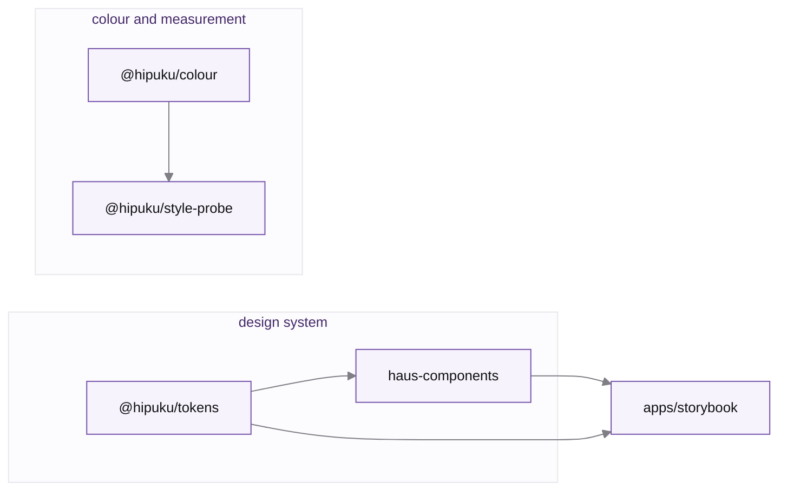
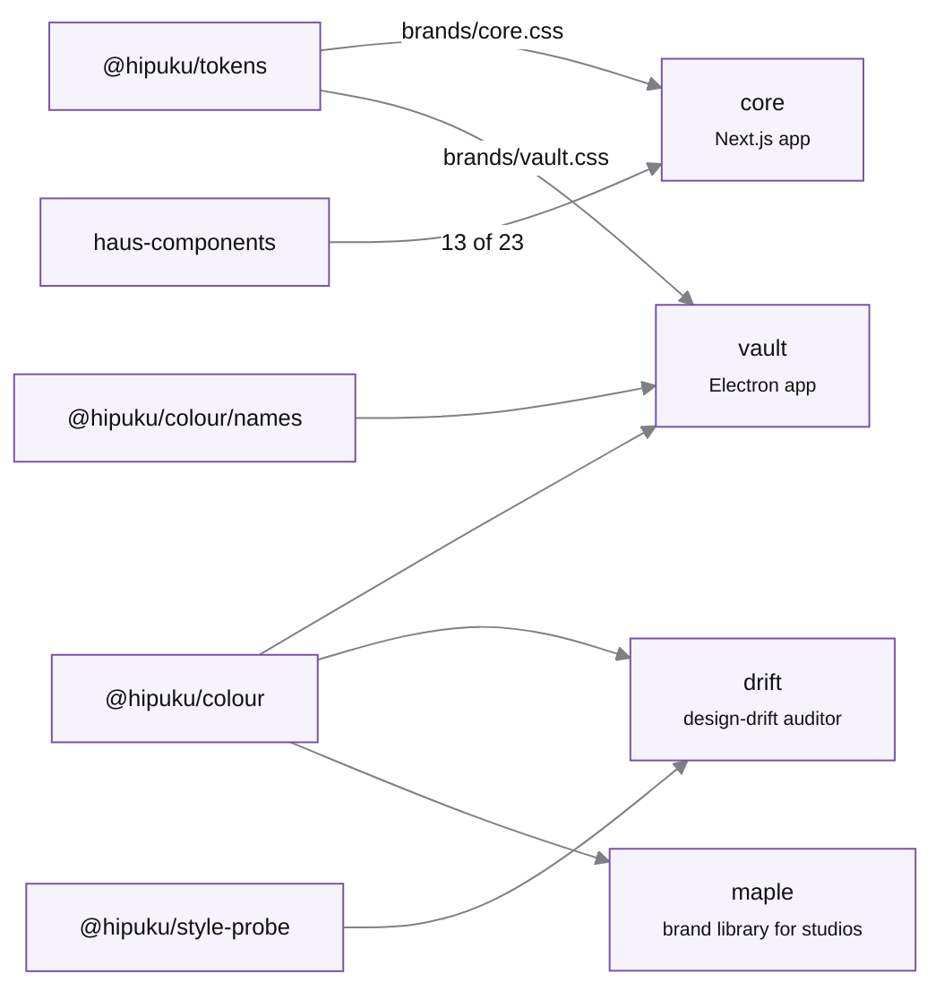
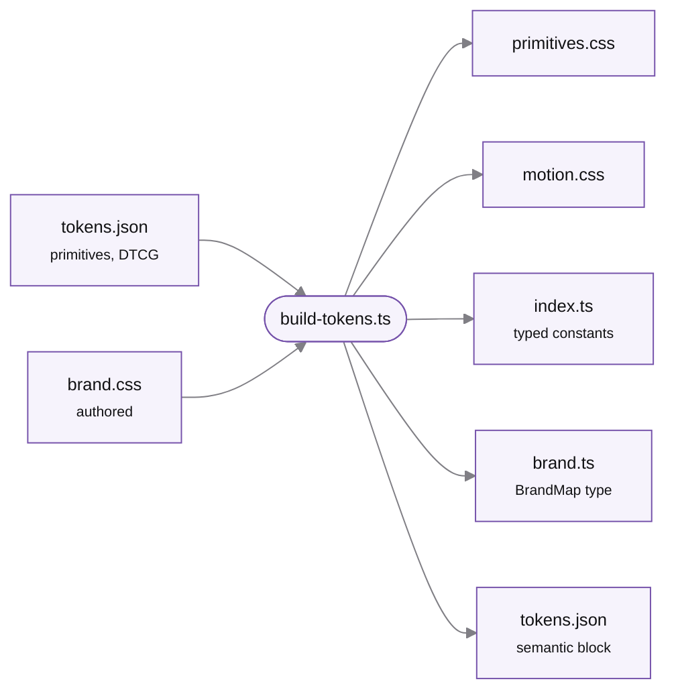
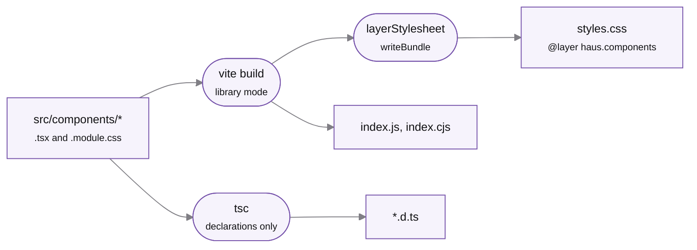

# haus: architecture

How the workspace is built: the five packages and what depends on what, which products consume
which packages, how the token files are generated, how the components are compiled, how a release
reaches npm, and what is tested. The design decisions themselves are in [`DESIGN.md`](./DESIGN.md).

## Contents

- [Overview](#overview)
- [Packages](#packages)
- [Consumers](#consumers)
- [Token build](#token-build)
- [Component build](#component-build)
- [Colour utilities](#colour-utilities)
- [Style probe](#style-probe)
- [Boundaries and security](#boundaries-and-security)
- [Publishing](#publishing)
- [Testing and CI](#testing-and-ci)
- [Platform and stack](#platform-and-stack)
- [Known trade-offs](#known-trade-offs)

## Overview

A pnpm workspace with packages under `packages/` and two apps. `apps/storybook` consumes the built
packages the way an outside project would. `apps/docs` is the documentation site, Next and Fumadocs,
with one page per component in `registry.json`; it renders the Storybook stories through
`composeStories` and generates each API table from the component's source. Two packages are the design system
(`@hipuku/tokens`, `haus-components`); three are the colour and measurement libraries that the
products' auditing and colour tools were written against. Each is versioned and published on its
own, and none is private to the workspace.

Inside the workspace a package depends on another through `workspace:^`, resolved through the
dependency's `dist/`. That directory is gitignored, so nothing typechecks or tests across a package
boundary until the workspace is built; CI builds first for that reason.

## Packages

| Package               | Version | What it ships                                                                                                   | Depends on       | Built with |
| --------------------- | ------- | --------------------------------------------------------------------------------------------------------------- | ---------------- | ---------- |
| `@hipuku/tokens`      | 6.0.1   | Six stylesheets, the brand files, typed constants, DTCG JSON, and the token guard                               | nothing          | tsup       |
| `haus-components`     | 3.2.0   | 23 React components and one stylesheet                                                                          | `@hipuku/tokens` | Vite, tsc  |
| `@hipuku/colour`      | 0.1.1   | Contrast, CIEDE2000, clustering, name matching, OKLCH and hue families; 31,900 named colours on `/names`        | `chroma-js`      | tsc        |
| `@hipuku/style-probe` | 1.0.2   | Computed-style extraction in the page, normalisation in Node                                                    | `@hipuku/colour` | tsup       |
| `@hipuku/dtcg`        | 0.1.1   | Token conversion between DTCG, Figma, Tokens Studio and Tailwind v4, with a loss report, and the `dtcg` command | `culori`         | tsc        |

Every package above is live on npm, released through CI with provenance. `@hipuku/tokens` and
`haus-components` publish ESM and CommonJS with their own types, and `main` points at the
CommonJS build so a bundler or runtime that falls back to `main` gets a file it can load. The
other `@hipuku/*` packages are ESM only. `haus-components` has `react` and `react-dom` 18 or 19
as peers.

`@hipuku/config` 0.1.1 and `@hipuku/motion` 0.1.1 are live as well: shared tool configuration and
the motion engine.

The old names are deprecated, not unpublished: `haus-tokens` 5.2.1, `haus-colour-utils` 1.0.2,
`haus-colour-names` 1.0.1 and `haus-style-probe` 1.0.1 each have a final release and still
install, so a consumer on one keeps working until it moves.

## Consumers

Four products use haus, each through the packages it needs and nothing else, which is why there is
no meta-package ([decision 0007](./DESIGN.md#0007-meta-package)).

| Product | Packages                                                                     | How it uses them                                                                                                                                                                                                                                                                                      |
| ------- | ---------------------------------------------------------------------------- | ----------------------------------------------------------------------------------------------------------------------------------------------------------------------------------------------------------------------------------------------------------------------------------------------------- |
| core    | `haus-tokens` ^5.2.0, `haus-components` ^3.1.0                               | Imports the six token stylesheets and `brands/core.css`, then `haus-components/styles.css`. Renders 13 of the 23 components, including stateless ones from Server Components.                                                                                                                         |
| vault   | `haus-tokens` ^5.2.0, `haus-colour-utils` ^1.0.0, `haus-colour-names` ^1.0.0 | Imports the token stylesheets and `brands/vault.css`, and builds its own components on the roles. Uses `hueFamily` to sort colours and the name data for its two-pass name search. Its side is in [vault's ARCHITECTURE.md](https://github.com/hipuku/vault/blob/main/ARCHITECTURE.md#haus-packages). |
| drift   | `haus-colour-utils` ^1.0.0, `haus-style-probe` ^1.0.0                        | Runs `extractRawElements` in each crawled page and `normaliseElement` on the result, then `clusterByPerceptualDistance`, `wcagContrast`, `deltaE` and `hueFamily` in its audit.                                                                                                                       |
| maple   | `haus-colour-utils` ^1.0.0                                                   | `oklch`, `toHex` and `generateLightnessScale` build each client colour's scale, `deltaE` and `nearestNamedColour` name it, and `wcagContrast` checks its pairs. maple's repository is private, so it is not linked.                                                                                   |

The products above still install the published `haus-colour-utils` and `haus-colour-names`, which in
this repository are now `@hipuku/colour`. They move when it is published (plan steps 1.8 and 1.9).

hexicon was a fifth until 2026-11-23. Its palette analysis moved into `@hipuku/colour` and the
repository was archived, so it is no longer a consumer.

A brand reaches a product as one stylesheet scoped by `data-haus-theme`, so core and vault share
every role name and differ only in the primitives their brand file chooses.

## Token build

`packages/tokens/scripts/build-tokens.ts` generates every derived file under `src/` from two
sources:

- `pnpm --filter @hipuku/tokens run tokens` writes them; `tokens:check` fails if any differs from what
  the generator would write. CI runs the check, and `prepublishOnly` runs it before a publish.
- `BrandMap` is generated from `brand.css`, so a brand file that omits a required entry is a type
  error in a product's own checks rather than an unresolved `var()` at runtime.
- `semantics.css` is authored, not generated. Its typography roles, the focus ring, `color-scheme`
  and the relative-colour alpha tokens have no source in `tokens.json`.
- tsup bundles the typed constants and the guard; the stylesheets and the JSON are copied into
  `dist/` as they are, because they are the source form.

### Handoff format

**Decision.** `tokens.json` follows the W3C Design Tokens format, and ships in the package.

**Reason.** Style Dictionary, Theo and any pipeline that reads the format can take haus tokens
without haus-specific tooling. The custom properties are the runtime format; the JSON is the format
for tools.

### Token guard

`@hipuku/tokens/guard` is a second entry point with three pure functions that take CSS as strings:
`findUndefinedTokens` (a stylesheet reads a property nothing defines), `findFallbackTokens` (a
property only ever read with a fallback, which is a hardcoded value in effect), and
`findRestatedTokens` (a consumer overrides a role to the value haus already gives,
[decision 0016](./DESIGN.md#0016-restated-values)). It reads
no files, so it runs in a test, a script or a browser.

## Component build

- **Vite, not tsup.** tsup routes every stylesheet through esbuild's global CSS loader, which turns
  each `.module.css` into global CSS and hands the component an empty styles object. Vite's PostCSS
  pipeline scopes CSS Modules.
- **One layered stylesheet.** The modules are concatenated into `styles.css`, and a Vite plugin
  wraps the file in `@layer haus.components` after it is written
  ([decision 0006](./DESIGN.md#0006-component-stylesheet-layer)).
- **No `use client`.** The package ships no client directive, so a React Server Component can import
  it. Ten components can render there: Avatar, Badge, Button, Callout, Card, Divider, EmptyState,
  IconButton, Spinner and Toast. The other ten hold state, an effect, a generated id or a portal, and
  need a client boundary. The rule that keeps this safe, and the test behind it, are in
  [decision 0024](./DESIGN.md#0024-server-component-guard).
- **Icons are drawn inline.** The package declares `@hipuku/tokens` and the React peers and nothing
  else, so there is no icon font to load.

## Colour utilities

`@hipuku/colour` wraps `chroma-js` for the operations the products share: WCAG contrast with AA
and AAA verdicts, CIEDE2000 distance, single-linkage clustering by perceptual distance, a lightness
ramp, nearest named colour (CIE76 to shortlist, CIEDE2000 to rank), and OKLCH conversion with a
hue family.

### Hue families

**Decision.** `hueFamily` bins OKLCH hue into eight families at boundaries fitted to named colours:
the set that maximises mean per-family recall over 4,275 names from the colour-name dataset whose names
end in a family word. Two edges are set by hand. Orange ends at 72 rather than the fitted 70, so
`#ffa500` stays orange. Hue 328 is purple, because purple and magenta cannot be separated by hue
(`#800080` and `#ff00ff` are both at 328) and far more real colours there are called purple.

**Reason.** Mean per-family recall rose from 0.62 to 0.78. Per-family recall rather than accuracy,
because there are five times as many labelled greens as oranges, and accuracy rises when a small
family is emptied into a large neighbour. `hue-families.test.ts` rebuilds the labelled set, holds
recall above 0.77, and asserts every family is reachable.

**Alternatives.** Midpoints between the hues of the eight namesake colours. It assumed each family
is centred on its namesake: the median orange is at hue 47 while `#ffa500` is at 71, so most oranges
were filed as red.

## Style probe

`@hipuku/style-probe` is split at the browser boundary. `extractRawElements` runs in the page and
returns `getComputedStyle` strings untouched; `normaliseElement` runs in Node and parses them into
typed values (colour to hex, line height to a unitless ratio, letter spacing to em). Nothing is
parsed inside the page, so the browser half stays small and every parsing rule is a pure, testable
function.

`extractRawElements` reaches the page as source text through `page.evaluate`, so tsup's `keepNames`
stays off: it wraps functions in a helper that does not exist in the page, and the evaluated body
would throw.

## Boundaries and security

The published code makes no network requests and reads no files. The components render props into
DOM attributes and none uses `dangerouslySetInnerHTML`. Releases are published from CI with npm
provenance, so a published version can be traced to the commit and workflow that built it.
[`SECURITY.md`](./SECURITY.md) covers what is in scope and how to report a problem.

## Publishing

One workflow, `.github/workflows/publish.yml`, publishes one package per tag. The tag is
`<directory>-v<version>`, for example `components-v3.1.1`.

1. The tag is split, and the run stops unless `packages/<directory>/package.json` has that version.
2. If that version is already on npm, the run ends there, so a tag can be written after the fact.
   That holds for a tag on a commit whose workflow has this check: Actions runs the workflow as it
   was at the tagged commit, so an older one fails at npm instead
   ([`RELEASING.md`](./RELEASING.md#tagging-a-release-that-already-happened)).
3. Every workspace dependency must already be on npm at the version the manifest names; pnpm writes
   that version into the published manifest.
4. The whole workspace is built and the package's tests run.
5. pnpm packs the tarball, rewriting `workspace:^` to real versions, and npm publishes it.

npm authenticates the workflow by trusted publishing: GitHub issues a short-lived OIDC token, and npm
checks it against the publisher registered on the package. No npm token is stored. The order
dependencies must be released in, and how to cut a release, are in [`RELEASING.md`](./RELEASING.md).

### Versioning

**Decision.** Each package has its own semantic version. A renamed token is a major release at an
identical value, and a contrast change is a major even when the value barely moves
([decision 0004](./DESIGN.md#0004-versioning)).

**Reason.** A token's name and its measured contrast are both part of the contract a consumer
relies on; neither is an implementation detail.

## Testing and CI

| Package               | Test files | Tests |
| --------------------- | ---------- | ----- |
| `haus-components`     | 30         | 506   |
| `@hipuku/style-probe` | 2          | 81    |
| `@hipuku/tokens`      | 4          | 71    |
| `@hipuku/colour`      | 4          | 73    |

1168 tests in Vitest. The component suites run in jsdom with `css: false`, so they assert markup,
behaviour and accessibility, not computed styles. `ssr.test.tsx` renders every component to a string
in a Node environment, and `rsc-rules.test.tsx` checks the Server Component rule. Each package's
`vitest.config.ts` sets coverage floors, and CI runs the suites with coverage so the floors are
enforced.

CI runs five jobs on every pull request and on `main`: Lint (ESLint, Stylelint and the prose check),
Format (Prettier), Typecheck, Test, and Build (`tokens:check`, the packages and Storybook), which
runs after the other four pass. Chromatic snapshots every story on pull requests and on `main`; a
visual change waits for a person to accept it and never fails the build. CodeQL scans the code and
the workflows. The checks and the rules for merging are in [`WORKFLOW.md`](./WORKFLOW.md).

Nothing renders the components in a real browser except Chromatic, and nothing runs a screen reader.

## Platform and stack

### Workspace

**Decision.** One pnpm workspace with five separately published packages.

**Reason.** A project that needs only the tokens does not install the React components; a server
using the colour utilities does not pull a browser bundle; and a project that wants CIEDE2000 does
not pay 764KB for 31,900 names it never asks for. pnpm's workspace links resolve across packages
without manual linking.

### Build tools

**Decision.** tsup for the four packages without stylesheets to compile, Vite for the components.

**Reason.** The components need their CSS Modules scoped, which tsup's CSS handling does not do
(see [Component build](#component-build)).

### Node

**Decision.** Node 22.12 or later, enforced by `engine-strict` in `.npmrc`.

**Reason.** The suites fail on Node 20 with a jsdom error that looks like a code problem rather than
a version one.

## Known trade-offs

- **`semantics.css` is not checked against a source.** The generator covers the primitive layer and
  the brand map; the semantic layer has no generated counterpart, so only the tests that read it
  catch a mistake there.
- **The Server Component check is narrow.** It catches a ref attached unasked and nothing else; a
  hook or an event handler in a server tree would pass. A real RSC render harness was declined in
  decision 0024 as a dependency the package does not otherwise need.
- **Packages build before they typecheck.** Cross-package types resolve through `dist/`, so every
  CI job that typechecks or tests builds first.
