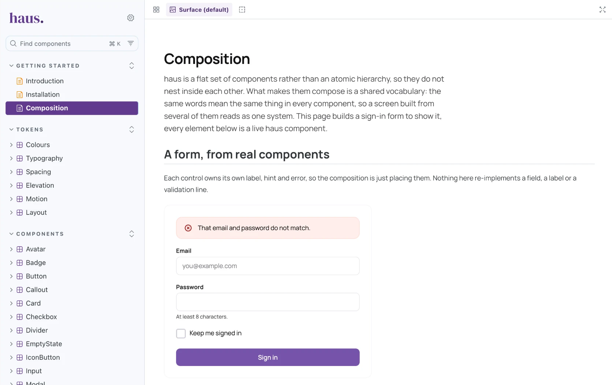

# haus

A token-first design system for React, published as five npm packages: OKLCH design tokens with a
replaceable brand layer, 20 accessible components built on them, and the colour and measurement
libraries underneath. Light mode only.



[](https://www.hipuku.dev/work/haus)
[](https://haus.hipuku.dev)
[](https://www.npmjs.com/package/haus-components)
[](https://www.figma.com/design/Qo23P38COlJrfQmlM39Fa3/haus-Design-System)

## At a glance

- **Four token layers.** Primitives, brand, semantics and motion, each in its own cascade layer;
  components read roles, never palette steps. [`DESIGN.md` § Layers](./DESIGN.md#layers)
- **Replaceable brand.** A brand is one file of 71 choices, and two products ship their own on the
  same contract. [`DESIGN.md` § Brands](./DESIGN.md#brands)
- **Accessible components.** Axe runs in all 20 component suites, every surface is measured
  against its paired ink, and every focus ring has a forced-colours fallback.
  [`DESIGN.md` § Accessibility](./DESIGN.md#accessibility)
- **Decided in the open.** 27 numbered decisions, each with what it was chosen over.
  [`DESIGN.md` § Decisions](./DESIGN.md#decisions)
- **Generated, not copied.** The primitives, the motion layer and the typed constants are generated
  from the token file, and the brand map type from `brand.css`; CI fails if either drifts.
  [`ARCHITECTURE.md` § Token build](./ARCHITECTURE.md#token-build)
- **Used by five products.** core, vault, drift, hexicon and maple each take the packages they need.
  [`ARCHITECTURE.md` § Consumers](./ARCHITECTURE.md#consumers)

## Documentation

| File                                   | Covers                                                                   |
| -------------------------------------- | ------------------------------------------------------------------------ |
| [`DESIGN.md`](./DESIGN.md)             | Tokens, brands, typography, components, accessibility and enforcement    |
| [`ARCHITECTURE.md`](./ARCHITECTURE.md) | Packages, consumers, the token and component builds, publishing, testing |
| [`WORKFLOW.md`](./WORKFLOW.md)         | Branches, pull requests, checks, review, keeping Figma and code in step  |
| [`docs/`](./docs/)                     | Reference: tokens, accessibility, browser support                        |
| [`CHANGELOG.md`](./CHANGELOG.md)       | What each package release changed, for a consumer                        |
| [`RELEASING.md`](./RELEASING.md)       | How a package is tagged and published                                    |
| [`CONTRIBUTING.md`](./CONTRIBUTING.md) | The rules a change is held to                                            |

## Install

```bash
npm install haus-tokens haus-components
```

```ts
import 'haus-tokens/index.css'
import 'haus-components/styles.css'
```

React 18 or 19 is a peer dependency. The colour libraries install on their own:
`haus-colour-utils`, `haus-colour-names` and `haus-style-probe`. Each package's README covers its
API.

## Develop

Node 22 (`.nvmrc`) and pnpm 10 (`packageManager` in `package.json`).

```bash
pnpm install
pnpm run storybook      # builds the packages, then serves Storybook on port 6006
```

## Scripts

| Command                    | Runs                                                    |
| -------------------------- | ------------------------------------------------------- |
| `pnpm run build`           | Every package                                           |
| `pnpm run lint`            | ESLint                                                  |
| `pnpm run lint:css`        | Stylelint, which fails a raw value where a token exists |
| `pnpm run lint:prose`      | The em dash check, against its baseline                 |
| `pnpm run lint:md`         | markdownlint                                            |
| `pnpm run knip`            | Unused files, exports and dependencies                  |
| `pnpm run figma:check`     | Code against the Figma file, see `WORKFLOW.md`          |
| `pnpm run test:scripts`    | The repository scripts' own tests                       |
| `pnpm run format:check`    | Prettier                                                |
| `pnpm run typecheck`       | `tsc` in every package                                  |
| `pnpm -r run test`         | Every test suite                                        |
| `pnpm run build-storybook` | The static Storybook                                    |

## Stack

React · TypeScript · CSS Modules · OKLCH · W3C Design Tokens · pnpm workspaces · tsup · Vite ·
Vitest · Storybook · Chromatic
